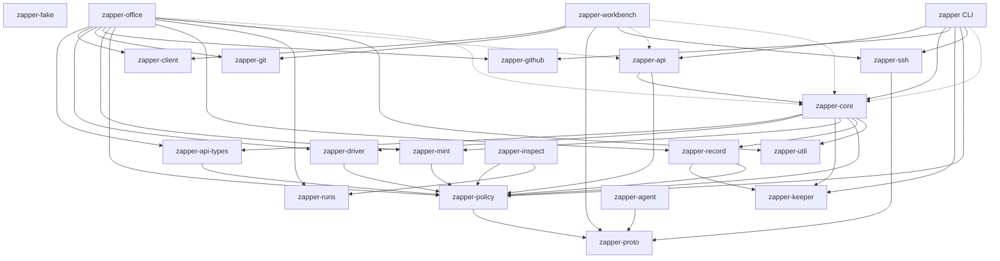

# Crate dependencies

The workspace's intra-crate dependency graph, and an assessment of it. Solid edges are normal dependencies; dotted edges are dev-only — the client layers (`zapper-office`, `zapper-workbench`) link `zapper-api`/`zapper-core` only in tests, reaching the daemon in production through `zapper-client` alone.

## Assessment

The tree is an acyclic, well-layered DAG with clear, non-overlapping responsibilities:

- **Base:** `zapper-proto` (host↔guest protocol) and `zapper-policy` (config model + rule evaluation, no I/O).
- **Daemon building blocks:** `zapper-api-types` (wire types), `zapper-driver` (agent harness over a stream), `zapper-record` (append-only record + keeper client), `zapper-mint` (host-command token cache).
- **The daemon:** `zapper-core` — the single crate holding `Core`, the only way into the daemon.
- **REST/UI:** `zapper-api` over `Core`.
- **Client layers:** `zapper-office` and `zapper-workbench`, both reaching the daemon through `zapper-client` in production (dotted `api`/`core` edges are tests only). The shared `client`/`git` edges show the P4 extractions working — neither layer re-implements the socket client or git-over-HTTP, and neither links `core` in production.
- **Composition root:** the `zapper` CLI wires the daemon, API and UI together.

This structure is close to optimal. The items below are refinements.

## Findings

1. **`firms:` is carried by the daemon but owned by the office.** `Remote::config()` fetches the whole `Config` (firms included) from the daemon's `/v1/config`, yet per the proposal-13 step-4 decision the daemon no longer validates or uses firms. The daemon stores and serves firm config it never reads; the office fetches config that is conceptually its own. The office genuinely needs `profiles:` from the daemon (profiles define the VMs the daemon enforces) but not `firms:`.
2. **Chattiness — two N+1 read patterns.** The VMs view calls `GET /sessions` then `GET /sessions/{id}/terminals` per session; the officers' traffic view calls `GET /sessions/{id}/requests` per worker. Both fan out page→office and office→daemon. (`admit(profile)` is the good counter-example — it returns the running config alongside the room decision, so the hire path makes one call, not two.)
3. **Three socket clients.** `zapper::client::Client`, `zapper-office`'s `cli::Client`, and `zapper-client::Zapper` (used by the workbench and the office's `Remote`) each hand-roll the same unix-socket + hyper handshake plumbing. `Zapper` is the shared one; the other two predate or specialise it (raw bytes, a non-JSON body).
4. **CLI helpers duplicated.** `print_json` / `table` / `s` and the config-path resolution are copied between `zapper`'s and `zapper-office`'s command-line code.
5. **Over-exposed office modules.** `zapper-office` exposes `pub mod firm` and `pub mod client`, but nothing outside the crate uses them (the binary only needs re-exports available from `zapper-client` directly). They can be `pub(crate)`.
6. **Redundant `zapper-api-types → zapper-proto` edge (fixed).** `zapper-api-types` reached the proto types it uses (`Forward`, `GuestFile`, `GuestEvent`) through `zapper_policy::proto::*` — `zapper-policy` re-exports `zapper_proto::{facility, proto}` — never via `zapper_proto::` directly. The direct dependency was vestigial and has been removed (the edge is gone from the diagram above).
7. **Minor:** `zapper-api → zapper-policy` is a direct edge, but the policy types the API bodies use are re-exported by `zapper-core`, which `api` already depends on — the direct edge is droppable.

See `docs/office-process-step4-plan.md` for the status of changes addressing these.
