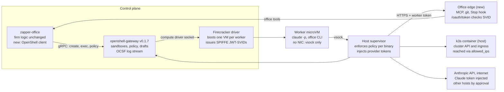

# Moving zapper-office onto OpenShell + Firecracker

2026-11-07 · Miles

## Summary

Recommendation: keep zapper-office's firm logic as it is, and replace only the layer under it. zapper-office already reaches the zapper daemon through one Rust trait, `OfficeClient` (`crates/zapper-office/src/client.rs`, about 20 methods). The smallest migration adds a third implementation of that trait, `OpenShell`, which talks gRPC to an OpenShell v0.1.7 gateway running the openshell-firecracker driver. It also adds one host-side **office edge** service that replaces the guest-to-daemon vsock port.

The smallest implementation has five parts:

1. **`OpenShell` client** implementing `OfficeClient` over the gateway API: `CreateSandbox`, `DeleteSandbox`, `ExecSandboxInteractive`, `ForwardTcp`, `UpdateConfig`, the draft-policy RPCs and `GetSandboxLogs`.
2. **Office edge**, one HTTP service on a private host address. It serves the office MCP tools (Streamable HTTP), the git server, the Stop-hook endpoint and an OAuth2 token endpoint that turns a sandbox's SPIFFE JWT-SVID into a worker identity.
3. **An `office` provider profile** with a `client_credentials` token grant. The supervisor injects the worker's short-lived token into every request to the firm's services, so no credential enters the VM. The Claude token uses the stock `anthropic` provider the same way.
4. **Officer queue on draft policy**: denials become drafts (`GetDraftPolicy`), and officer decisions become `ApproveDraftChunk` / `RejectDraftChunk` or a policy update.
5. **The k3s cluster runs in a sandbox of its own** and exposes its API and ingress as an OpenShell service that the workers' sandboxes dial (phase 4).

Rough size: about 10 engineer-weeks to cutover over 6 phases, then about 1 week for durable traffic history (Phase 6). The firm logic (mail, workforce, budgets, drive, contracts, scenarios, UI, journal, replay) stays unchanged. The main risk is that the vendored Firecracker driver hasn't booted a real sandbox yet, so Phase 0 is a de-risking spike with pass/fail gates.

## Current state: what zapper-office takes from zapper

zapper-office is already its own process. In production it reaches the zapper daemon only through `zapper-client` over the daemon's Unix socket (the `Remote` impl of `OfficeClient`), plus a vsock port inside each guest. Everything it needs from zapper falls into seven groups:

| Group | `OfficeClient` methods / mechanism | What zapper does for it |
| --- | --- | --- |
| Sessions | `create_session`, `stop_session`, `session`, `admit`, `session_count`, `config` | Boots a Firecracker VM from a zapper profile (image, size, network, secrets); checks host memory and `max_sessions` |
| Driving the agent | `attach` (terminal stream), `connect_port` | Terminal channel into the guest; the foreman runs `claude -p --input-format stream-json` over it. Also copies files in and out for `drive_publish` / `drive_fetch` |
| Guest → office calls | vsock port `office`, `zapper-agent office` (MCP stdio server + CLI + `stop-hook`) | One JSON request per connection. The daemon knows the caller from the vsock socket, so no token is needed |
| Network rules | `add_layer_rule`, `remove_layer_rule`, `reset_layer` (role layers); `put_session_rule`, `remove_session_rule` (worker layer); `allowed`; `promote_rule` | Layered allow/deny/ask rules (global → profile → role → session), applied live to running VMs |
| Access decisions | `add_decider_socket`, `remove_decider` | Sends each `ask` to the office's decider socket, which refuses at once and queues it for an officer |
| Traffic | `requests` | The proxy's request log per session: method, URL, status, sizes, deciding rule |
| Firm services | `add_service`, `add_zone`, `remove_service`, `add_mcp_socket`, `remove_mcp_server` | Names under `<firm>.internal` that resolve only inside the firm. The daemon splices connections to the office's git server, the cluster VM's API and ingress, and the office MCP gateway |

Three more things come from zapper underneath and are easy to miss:

- **Secrets as placeholders.** The Claude token is substituted by the host proxy, never placed in the VM.
- **Exec gating.** A guest seccomp filter makes every exec wait for the host's allow/deny decision, and logs it. The office forbids `ask` on exec, so only allow/deny lists are in use.
- **The record.** zapper keeps audit logs, terminal recordings and an optional append-only keeper per session. `run.json` links them from the firm's run.

## Target state

In the target state, zapper-office drives OpenShell's gateway instead of the zapper daemon. Every byte a worker sends leaves its VM over vsock to its host supervisor, which enforces the sandbox's policy and attaches the worker's identity before the request reaches the office.

OpenShell supplies isolation, policy, credentials and identity. zapper-office keeps everything that makes it a company: mail, budgets, hiring, the drive, security officers and the record.

## Required changes, capability by capability

Most capabilities map directly onto an OpenShell v0.1.7 RPC. Three need new office code before cutover: the guest-to-office channel, role-wide rules and the cluster. Durable traffic history comes later, in Phase 6. Two are accepted losses: per-exec host approval and `once`-scoped approvals.

| zapper capability | OpenShell + openshell-firecracker equivalent | Change in zapper-office | Size |
| --- | --- | --- | --- |
| `create_session` from a profile | `CreateSandbox` with a sandbox template per role (image, CPU/memory, base policy, attached providers). Image `ENV`/`WORKDIR` are honoured by the vendored driver | Translate zapper profiles to templates; write the preamble, skills and `mcpServers` config into the sandbox after create | M |
| `stop_session`, `session`, `session_count` | `DeleteSandbox`, `GetSandbox`, `ListSandboxes`, `WatchSandbox` | Thin mapping | S |
| `admit` (host room) | Gateway `resource_admission`; no free-memory check | Keep the office's own `/proc/meminfo` check before create | S |
| `attach` (foreman drives `claude -p`) | `ExecSandboxInteractive` (bidirectional stdin/stdout stream) | Wrap the stream as a `DriveStream`; restart with `--resume` when the stream drops, as today | M |
| `drive_publish` / `drive_fetch` file copy | `ExecSandbox` running `tar` (or `openshell sandbox upload/download` over SSH) | Replace the terminal-channel copy with exec + tar, capped at `artifact_size` | S |
| `connect_port` (product, dashboard) | `ForwardTcp` | Only needed if the cluster stays a sandbox; with k3s on the host, the product port connects directly | S |
| vsock `office` port + `zapper-agent office` | No vsock to anything but the supervisor. The guest reaches host services through the supervisor proxy only | **New office edge**: MCP over Streamable HTTP at `office.<domain>`, plus `/stop-hook`. The guest CLI becomes a ~100-line HTTP client | L |
| Caller identity (vsock socket = VM) | Driver-issued SPIFFE JWT-SVID per supervisor (`spiffe://<td>/openshell/sandbox/<id>`), used as an OAuth2 client assertion by a provider token grant | **New token endpoint** in the edge: verifies the SVID against the driver's JWKS and issues a token naming the worker. Every edge route checks it | M |
| Claude token placeholder | `anthropic` provider; static credential bound to the vendor endpoint | Config only | S |
| Git server (per-worker password + source VM check) | Same token grant, injected on requests to `git.<domain>` | Drop per-worker passwords; `git http-backend` behind the edge checks the bearer token, then the grant | S |
| Role-layer rules | None: policy is per sandbox (base + provider rules) or global | Fan out: the office keeps role rules and writes them into every sandbox of the role with `UpdateConfig` | M |
| Session-layer rules, revocation | `openshell policy update` semantics via `UpdateConfig`; changes load live and close connections opened under old rules | Thin mapping. Rules need a `binaries` list: use the agent image's known binaries, or a glob if v0.1.7 accepts one (to check) | M |
| `ask` + decider socket | No hold. Denied connections are drafted automatically into per-binary proposals (`GetDraftPolicy`); the policy advisor (`policy.local`) lets agents propose rules with a reason | Officer queue reads drafts; `access_decide` → `ApproveDraftChunk` / `RejectDraftChunk`; workers ask through `policy.local`, and `request_access` is gone. zapper also refused at once | M |
| `allowed` (would this be allowed?) | Policy prover / effective policy (`GetSandboxConfig`) | Evaluate the host and port against the effective policy in the office | S |
| `requests` (traffic log) | OCSF `NET:OPEN` / `HTTP:*` events in `WatchSandbox` / `GetSandboxLogs`; the gateway keeps only 2,000 lines per sandbox in memory | **Interim:** `requests()` reads recent events on demand with `GetSandboxLogs`, with no ingest. **Phase 6:** query history from telemetry and the audit extension | S |
| Services and zones (`*.<firm>.internal`) | No zones. The supervisor resolves names on the host; private addresses are allowed for exact hostnames, and loopback never | Bind the edge on a private host address (a dummy interface); resolve `office.`, `git.` and `cluster.` names on the host (`/etc/hosts` or dnsmasq) | S |
| k3s cluster facility (own kernel, NIC, vsock forwards) | Not a good fit: the driver boots one kernel per driver, and guests have no NIC | Run k3s as a host podman container per run; workers reach `cluster.<domain>:6443` with `allowed_ips`; kubeconfig copied in by exec | M |
| Per-exec host approval + exec log (seccomp) | No equivalent; Landlock, seccomp and binary-scoped network rules instead | **Accepted loss.** Office profiles already allow or deny exec without `ask` | — |
| Audit log, terminal recordings, keeper | Gateway OCSF JSONL (`ocsf_log`) for gateway events; supervisor logs are not durable | The office keeps transcripts as today; traffic history comes from telemetry and the audit extension in Phase 6. No terminal recordings | S |
| `promote_rule` (save to config) | Global policy, or a role template | Write the rule into the role's template or the office config | S |

Size: S is under 2 days, M is 3 to 5 days, L is 1 to 2 weeks.

## The smallest implementation

The smallest change that keeps every office feature is one new trait impl, one new HTTP service, two provider profiles and a template per role. Nothing above `OfficeClient` changes, so mail, workforce, budgets, contracts, scenarios, the drive, the UI, the journal and replay come across as they are.

### What gets built

1. **`zapper-office/src/openshell.rs`: `struct OpenShell` implementing `OfficeClient`**, using the OpenShell Rust SDK (gRPC, mTLS to the gateway). It keeps a map from worker to sandbox id and the office's own role-rule table, which it fans out with `UpdateConfig`. Methods with no OpenShell meaning (`add_zone`, `add_service`, `add_decider_socket`, `add_mcp_socket`) become no-ops that return an id. Their job moves into the edge and the provider config.
2. **`office-edge`**, an axum service bound to a private host address, for example `10.231.0.1:443` on a dummy interface with a certificate from the office's CA (but see the TLS open question). Routes:
    - `POST /oauth/token`: verifies the JWT-SVID with the driver's JWKS (`127.0.0.1:8961`), maps sandbox id to worker, and returns a 5-minute token.
    - `/mcp`: the office tools over MCP Streamable HTTP, dispatching to the same `ops.rs` handlers the vsock port uses today. Role scoping and authority checks are unchanged.
    - `/stop-hook`: the Stop hook's "any new mail?" call.
    - `git.<domain>/*`: the existing `git http-backend` handler, with the bearer token replacing the per-worker password.
3. **Provider profiles.** `office` uses `token_grant: client_credentials`, `token_endpoint: https://office.<domain>/oauth/token`, with endpoints `office.<domain>:443` and `git.<domain>:443`. The stock `anthropic` profile carries the Claude subscription token. Both are attached to every worker sandbox.
4. **Sandbox templates per role**, generated at `firm up` from today's zapper profiles: image (`office`, plus a small `office` HTTP CLI replacing `zapper-agent office`), CPU and memory, and a base policy. The base policy contains the Anthropic API, the office services pinned with `allowed_ips: [10.231.0.0/24]`, and the profile's allowed hosts. `cluster.<domain>` is added only when granted.
5. **Traffic, interim**: `requests()` reads each worker's recent OCSF network events from `GetSandboxLogs` when an officer tool, the digest or the rule-use count asks for them. That covers what officers use today, within the gateway's 2,000-line buffer per sandbox. There's no ingest task; durable history is Phase 6.
6. **Cluster on the host**: `podman run rancher/k3s` per run, its API and ingress on the same private address. The office already creates service accounts and kubeconfigs; it now does this with `kubectl` on the host, then copies the kubeconfig in with `ExecSandbox`.

### What it deletes

The office stops depending on the zapper daemon: `zapper-client`, `zapper-driver`'s terminal transport, `zapper-record` and the daemon's rule layers. `zapper-github` and `zapper-mint` stay as libraries for the GitHub App tokens, and `zapper-policy`'s config types stay until firm profiles move into `office.yaml`. The guest-side `zapper-agent office` and the vsock port go. So do the cluster's custom `vmlinux-6.1-k8s` kernel and its vsock forwards.

### Behaviour that changes

- **`ask` becomes deny + draft.** The agent sees a 403 with OpenShell's text (`policy_denied`) instead of zapper's request id, and asks by proposing a rule through `policy.local`. `request_access` is gone. The officers decide it as before, and the decision still mails the worker.
- **`once` approvals** are approved as worker rules with a 10-minute expiry, which the office removes. Exact once-only semantics need an `HTTP:*` log match, so they're out of scope.
- **Network rules are binary-scoped.** That's stricter than zapper's host rules, and drafts arrive per binary.
- **No per-exec record and no terminal recordings.** Transcripts and traffic remain.

## Workplan

The work runs in six phases over about 10 weeks for one engineer to cutover, then a later Phase 6 for traffic history. Phase 0 settles the open technical questions before any office code changes. Each phase ends at a gate tested with the existing fake-Claude e2e scripts (`tests/fake`).

```mermaid
gantt
    title About 10 weeks to cutover; traffic history follows in its own phase
    dateFormat X
    axisFormat W%s
    section Phases
    0 Spike and de-risk (go/no-go)   :p0, 0, 2
    1 OpenShell client               :p1, 2, 3
    2 Office edge and identity       :p2, 3, 5
    3 Policy, officers, traffic      :p3, 5, 7
    4 Cluster and facilities         :p4, 7, 8
    5 Cutover and e2e suite          :p5, 8, 10
    6 Traffic history (later)        :p6, 10, 11
```

Estimated weeks for one engineer. Phases 2 and 3 can run in parallel with a second engineer, saving about 2 weeks.

### Phase 0: Spike and de-risk (weeks 1 to 2)

- [x] Boot the vendored v0.1.7 driver with sub-uids on; run 10 concurrent sandboxes on the `office` image for 4 hours.
- [x] Run `claude -p --input-format stream-json` through `ExecSandboxInteractive`, with the `anthropic` provider supplying the token.
- [x] Turn on supervisor identity; complete a `client_credentials` token grant against a stub `/oauth/token`; confirm injection on a private-address host.
- [x] Settle TLS from the supervisor to a host service (see risks).
- [x] Confirm a denied request produces a draft in `GetDraftPolicy`, and that `binaries` accepts a glob.

Gate: all five pass. Otherwise stop, or fix in openshell-firecracker first. (Verified.)

### Phase 1: OpenShell client (week 3)

- [x] `OpenShell` impl of `OfficeClient`: sessions, `attach`, `admit`, `config`; profiles become sandbox templates (`crates/zapper-office/src/openshell.rs`, feature `openshell`).
- [x] File copy for `drive_publish` / `drive_fetch`: the drive's existing `tar` over `attach`, which is `ExecSandboxInteractive` here, so no separate `ExecSandbox` path is needed.
- [ ] Run the gate on a gateway (below).

How to run it (as of now): `make build`; `make image IMAGE=office-fake` (the recipe and the OpenShell layer in one build); create the gateway's `anthropic` provider; edit `config/openshell.yaml`; `zapper-office serve` (it reads `config/openshell.yaml`); then start a firm whose roles use `office-fake` profiles (as `tests/e2e-office.sh` writes them) with `zapper-office firm up`.

What phase 1 leaves to later phases: rules are kept and `allowed` judges by them, but nothing enforces them at the network (phase 3); `requests()` is empty (phase 3); the office MCP server, git server and decider are served but no sandbox reaches them, so their registrations are no-ops, and a fake worker's office tool calls fail (phase 2 adds the edge that serves the tools and git); `promote_rule` and port forwards (the cluster) refuse (phases 3 and 4). Commands run as the sandbox user, never root, and `{{secret:…}}` values in profiles are left out, since the gateway's providers hold credentials.

Gate: a fake-Claude firm boots and the foreman takes turns.

### Phase 2: Office edge and identity (weeks 4 to 5)

- [x] Office edge (`crates/zapper-office/src/edge.rs`): `/oauth/token`, the office's MCP tools over Streamable HTTP at `/mcp` (the same `ops.rs` handlers), git behind the edge's tokens at `/git/<repo>.git`. The Stop hook is the `stop_check` tool call, so it needs no route of its own.
- [x] `office-edge` provider profile (`config/openshell-office-edge.yaml`); image update (`zapper-office image` installs `zapper-agent` as `office`, whose CLI, stop hook and stdio bridge speak HTTP to the edge when `ZAPPER_OFFICE_URL` is set; Claude Code's `mcpServers` entry is type `http`).
- [ ] Run the gate on a gateway (below).

How it works:

- **One address, no host DNS.** The edge listens on host loopback (`127.0.0.1:8970`), which the supervisors reach for `host.openshell.internal` (the Firecracker driver's host alias). A token endpoint may be plain HTTP only on loopback, so this is also what lets the whole edge be plain HTTP with no certificate. Git is path-routed (`/git/<repo>.git`) rather than at `git.<firm domain>`, so no names under `<firm>.internal` are needed on the host; workers get the edge's URLs in their preamble.
- **Identity.** Each supervisor posts its sandbox's JWT-SVID to `/oauth/token` as a `client_credentials` client assertion. The edge checks it against the driver's JWKS (ES256, issuer, audience = the token endpoint, expiry, `jti` not reused) and takes the sandbox UUID from `spiffe://<trust domain>/openshell/sandbox/<uuid>`. The OpenShell client records each sandbox's UUID when it creates it, so the edge maps it to the worker's labels (firm, run, member); a sandbox the office doesn't run gets no token. The edge issues an opaque 5-minute token, which the supervisor adds to the worker's requests to the edge, replacing any `Authorization` the guest sent.
- **Every request is checked.** The supervisor only injects for the profile's endpoint and binaries; any other request reaches the edge with whatever the guest sent, so `/mcp` and `/git/` refuse anything but a current token the edge issued, for a sandbox the office still runs. Requests that name an `Origin` are refused.
- **Git.** The worker's grant is checked on every request as before; through the edge, the token replaces the per-worker password, so no `.git-credentials` is written.
- **Not yet:** the officers' decider (phase 3). Network rules are still not enforced, so the profile's endpoint is the only rule for the edge.

How to run it: on top of phase 1's steps, turn on the driver's supervisor identity (`OPENSHELL_VM_SUPERVISOR_IDENTITY=true`); `make image IMAGE=office-fake` again (it installs `zapper-agent` as `office`); `openshell profile import -f config/openshell-office-edge.yaml` and `openshell provider create --name office-edge --type office-edge --runtime-credentials`; add `office-edge` to `providers:` in `config/openshell.yaml`; then start the firm as in phase 1.

Gate: e2e for delegation, authority, identity (the sender is the sandbox), mail privacy and git grants passes.

### Phase 3: Policy, officers, traffic (weeks 6 to 7)

- [x] Role-rule fan-out and worker rules through `UpdateConfig`; expiry timers; revocation (`crates/zapper-office/src/openshell_rules.rs`, `openshell.rs`).
- [x] Officer queue from drafts; `access_decide` approves (narrowed if the officer says so), rejects or undoes them. Workers ask through `policy.local`; `request_access` is removed.
- [ ] Interim traffic: `requests()` over `GetSandboxLogs` (recent events only, matched rule parsed from `[policy:<rule>]`); digest wakes.
- [ ] Run the gate on a gateway (below).

How it works:

- **Rules.** The office keeps a worker's layers as before: its own, its role's, its profile's and the global one. Each sandbox's policy gets the allows among them as rules named `zo_<rule id>`, through `UpdateConfig` merge operations. A change to a role's layer is applied to every sandbox in the role. Rules are applied once a sandbox is up, before its first turn, and again whenever a layer changes; the office diffs against what it last applied, so only changed rules are sent.
- **What stays out.** OpenShell denies whatever no rule allows, so zapper's `deny` and `ask` rules aren't sent. A nearer layer's deny of the same host and port keeps a wider layer's allow out. Also left out: the firm's own git and cluster rules (the edge serves git, and checks grants itself), rules that inject secrets or headers (the providers hold credentials), database protocols, and hosts OpenShell can't match (`*` alone, or a wildcard name with fewer than three labels). zapper's rules name no programs, so each rule lets through `rule_binaries` from `openshell.yaml`, by default `/**`; the Phase 0 spike confirmed that `binaries` accepts a glob.
- **Asking.** Every sandbox the office makes has the policy advisor on (`agent_policy_proposals_enabled`, set per sandbox). A worker whose request is refused (`policy_denied`) proposes a rule through `http://policy.local` and can wait on it there. The office-resources skill tells them how. The sandbox also drafts a rule by itself for every connection it refuses.
- **Officers decide.** The office reads each sandbox's pending drafts every 5 seconds and files each as an access request. The officer sees the draft's origin (proposal or refusal), its programs, the rule as the gateway would apply it, and the gateway's own risk-check findings. `access_decide` maps onto the gateway:
    - **Allow:** `ApproveDraftChunk`, after an `EditDraftChunk` when the officer narrows `methods` or `path` (`methods: []` opens the whole connection, uninspected). A role-scoped allow also puts the rule on the role's layer, so the rest of the role gets it.
    - **Deny:** `RejectDraftChunk` with the officer's reason, which the worker reads. A standing denial refuses later drafts for the same host and port without asking anyone.
    - **Expiry and revocation:** `UndoDraftChunk` takes an approval back out. `once` lasts 10 minutes.
    - **Drafts that disappear:** a request whose draft leaves the gateway's pending list undecided (for example, replaced by a narrower proposal) is marked withdrawn.
- **Nobody else approves.** The office refuses to start against a gateway that sets `proposal_approval_mode` (other than `manual`), or that turns `agent_policy_proposals_enabled` off globally, since a sandbox's own setting can't override it.

Gate: e2e for a request refused, decided by an officer and retried, plus revocation, passes. Also check on the gateway: that a `/**` binary glob matches, that `UpdateConfig` merge operations apply live, and that an edited draft is approved with its fresh review token.

### Phase 4: Cluster and facilities (week 8)

- [x] k3s in a sandbox of its own per run (the `k3s` profile), started by the office rootless (OpenShell runs nothing as root), its air-gap images from the image and Traefik on ports 8080 and 8443. The office reaches its API, ingress and dashboard over the gateway (`connect_port`, OpenShell's `ForwardTcp`); the board's product and dashboard ports work as before.
- [x] Workers reach it through the office edge: the API at `/cluster` (each worker's kubeconfig names it, and holds no credential; the edge adds the worker's own service-account token, which the office keeps while the grant lasts, so RBAC still decides), and the ingress at `/apps/` (as `apps.<domain>`). `exec`, `attach` and `port-forward` aren't served through the edge.
- [ ] GitHub remote and knowledge base unchanged; re-test `publish_branch`.
- [ ] Run the gate on a gateway (below).

Why not an OpenShell service URL for the workers: a sandbox's network refuses loopback destinations even when a rule declares them (OpenShell's own test: "declared loopback must remain denied"), so a loopback gateway's service URLs can't be dialled from another sandbox; only `host.openshell.internal` is exempt, which is where the office edge listens. Service exposure suits the board's browser instead.

Gate: cluster e2e (grant, no grant, revocation, ingress, product port, cleanup) passes. Also check on a gateway: that k3s runs rootless in a Firecracker sandbox (user namespaces, cgroup v2 with its controllers, slirp4netns), that Traefik binds 8080/8443 and the dashboard's LoadBalancer 30466 through rootlesskit, and that `ForwardTcp` reaches them on the sandbox's loopback.

### Phase 5: Cutover (weeks 9 to 10)

- [ ] Port `make test-e2e-office`; one real-Claude two-worker run; one red-team scenario run.
- [x] Remove the daemon: zapper-core, zapper-api, the `zapper` CLI and the guest agent's PID 1 are gone; the office runs on OpenShell alone, its tests on an in-memory backend (`fake.rs`), and `zapper-office image` builds the images. The README, AGENTS.md and the quickstart describe the office on OpenShell; `docs/office.md` carries a note where it still describes the daemon's mechanics.
- [x] The workbench on OpenShell: only what OpenShell doesn't do (a drive, a repository, templates from it, labelled with their profile, and sandboxes made from them by `zapper-workbench new`, set up once the gateway says they are ready), on an edge of its own (`zapper-openshell::edge`, shared with the office); sandboxes, terminals, SSH, rules and secrets are OpenShell's.
- [x] The gateway workspace is `workspace:` in `openshell.yaml` (by default `default`), for the office and the workbench; the office labels its sandboxes with their profile and role (`zapper-profile`, `zapper-role`) beside firm, run and member.
- [x] Sandboxes' files and disks through openshell-firecracker's `driver_config` (its per-sandbox disk size and files): a worker's files and directories are staged under the driver's files root (`files_root:`) and copied in, as their owner, before its agent starts; `engine.disk` is the sandbox's writable disk. The office makes each worker's sandbox directly rather than from a template (its files are its own); the workbench's templates carry their profile's files, so a sandbox made from one in OpenShell's UI has them. Only setup commands still run after a sandbox is ready.

Gate: the full office e2e suite is green on OpenShell.

### Phase 6: Traffic history (later, about 1 week)

- [ ] Confirm the audit extension and telemetry keep network events with the sandbox ID and the matched rule, and how quickly events land there.
- [ ] Replace the interim `requests()` with a read adapter over that store; keep `GetSandboxLogs` for the digest count if the store lags by minutes.
- [ ] Link each run's traffic history from `run.json`, as zapper's session audit logs are today.

Gate: officers' `traffic()` and `access_rules()` counts cover a whole run, including after a gateway restart.

## Risks, open questions and decisions

The biggest risk is maturity rather than design. openshell-firecracker's own verification table says the vendored v0.1.7 driver has not run a sandbox, and sub-uids, concurrency and long-running guests are unchecked. A firm runs 5 to 15 concurrent, hours-long VMs.

| Risk or question | Impact | Mitigation or how to settle it |
| --- | --- | --- |
| Vendored driver not yet booted; concurrency and long runs untested | Blocks everything | Phase 0 gate: 10 concurrent sandboxes for 4 hours, with `rootfs-console.log` captured |
| TLS from the supervisor to the office edge: the supervisor must trust the edge's certificate, and `additional_ca_bundle` is rejected for external drivers | Office MCP and git unreachable over HTTPS | Phase 0 spike. Options: host trust store if the supervisor reads it; plain HTTP to a private address if token injection still works on `http`; or a publicly-trusted certificate for a real subdomain |
| Does a token grant inject on a non-default port or a private address? | Identity design | Phase 0 spike with a stub token endpoint |
| Binary-scoped rules: does v0.1.7 accept a glob in `binaries`? | Officer approvals per binary are noisier | Check the policy schema. Fallback: a fixed binary list per role image |
| Until Phase 6, officers see only the gateway's last 2,000 log lines per sandbox, held in memory | Older traffic in a busy run can't be queried; counts are lost if the gateway restarts | Accepted for the interim, since officers work on recent traffic. Phase 6 moves queries to telemetry and the audit extension |
| OpenShell API churn (middleware API marked evolving; driver pinned to v0.1.7) | Rework at upgrades | Use only gateway RPCs and provider profiles, not middleware. Pin gateway and driver together |
| Loss of per-exec gating and terminal recordings | Weaker record than zapper's | Decide whether that's acceptable for The Office (see decisions) |

**Decisions needed:**

- [ ] Accept losing per-exec host approval and exec audit, or require it (that would mean a supervisor change upstream).
- [x] Cluster: k3s runs in a sandbox, exposing a service other sandboxes dial (decided; phase 4 settles how k3s runs without a NIC on the shared guest kernel).
- [x] Cut over in one go: zapper's daemon is removed (decided).

## Sources

- [mr-miles/zapper](https://github.com/mr-miles/zapper): `docs/office.md`, `docs/crate-dependencies.md`, `crates/zapper-office/src/client.rs` (`OfficeClient`)
- [mr-miles/openshell-firecracker](https://github.com/mr-miles/openshell-firecracker): README (supervisor identity, verification status, limits)
- [NVIDIA/OpenShell](https://github.com/NVIDIA/OpenShell) at `v0.1.7`: `proto/openshell.proto`, `proto/supervisor_middleware.proto`, docs on policies, the policy advisor, provider profiles (token grants) and logs
