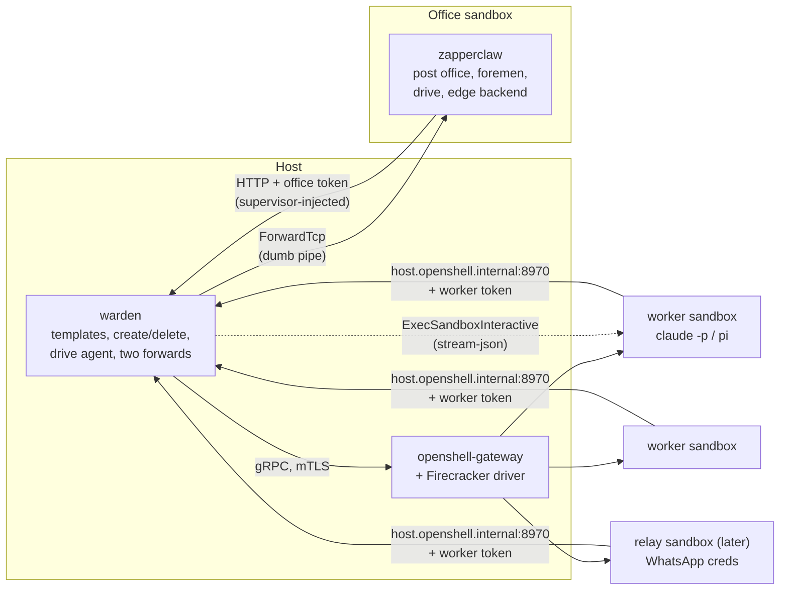

# zapperclaw: the post office in a sandbox

zapperclaw is the office cut down to what an always-on set of agents needs (a post office, a foreman per worker and a drive), with the office itself moved into an OpenShell sandbox. Only one small, trusted service is left on the host: the **warden**. It makes and drives sandboxes from fixed templates, and does nothing else. Channels (WhatsApp, Telegram, …) and scheduled tasks come later as **relays**: they post mail to the post office and send replies back out, and the warden doesn't change.

## Today

- `zapper-office` runs on the host with the gateway's mTLS client certificate (`config/openshell.yaml`), so it can do anything the gateway can.
- Everything it asks of the gateway goes through `OfficeClient` (`zapper-openshell/src/client.rs`). The `OpenShell` implementation (`sandboxes.rs`) uses `CreateSandbox`, `DeleteSandbox`, `GetSandbox`, `WatchSandbox`, `ExecSandboxInteractive`, `ForwardTcp`, `UpdateConfig`, `GetDraftPolicy` and `ApproveDraftChunk`/`RejectDraftChunk`.
- A worker's files (harness instructions, settings, MCP servers, the Stop hook) are staged under the driver's files root **on the host**, and openshell-firecracker copies them in at boot.
- Workers reach the office through the office edge on host loopback (`127.0.0.1:8970`, `host.openshell.internal` to them). The edge turns each sandbox's JWT-SVID into a short-lived token (`zapper-openshell/src/edge.rs`), and the supervisor adds it outside the VM.
- The foreman drives `claude -p --input-format stream-json` (or pi) through `attach`. It queues mail while a worker is in a turn, hands it over at the turn's end through the Stop hook, and restarts with `--resume` when the stream drops.
- `drive_publish` and `drive_fetch` copy files with `tar` over `attach`.
- Of the office's ~27k lines, the mail, foreman, journal, drive and edge code is under 5k. The rest is firm logic: workforce, contracts, plans, budgets, scenarios, security officers, access, facilities, product, knowledge base, GitHub.

## Decisions

| | |
|---|---|
| Where the post office runs | In an OpenShell sandbox of its own, the **office sandbox**. It holds no model credential and reaches nothing but the warden. |
| Host-side API | The **warden**: five HTTP routes, plus two plain TCP forwards. It accepts calls from the office sandbox only. |
| What the office may choose | A worker's name and profile, from the warden's list. Never an image, a policy, a provider, a command line or a file. |
| Network access beyond a profile's policy | Decided by a person through OpenShell's own drafts (its UI or `openshell policy`), never by the office. No security officers. |
| Firm logic | Gone: no hiring, budgets, contracts, plans, assignments' authority, scenarios or officers. Workers are a fixed roster in config. |
| Worker files | From templates the warden applies on the host (as `zapper-workbench apply` does). Nothing is staged per worker. Per-worker instructions come from the edge at start. |
| Drive | Served over the edge's HTTP (as the workbench drive is), not `tar` over exec. |
| Channels and schedules | Later, as relays that send and receive mail. A channel relay is a sandbox of its own, holding that channel's credentials. The scheduler is a relay inside the office. |

## The shape



Two directions cross the boundary, and the warden parses only the first:
- **Office → warden** (control). The office's supervisor adds the office's token; the warden checks that it names the office sandbox, then acts.
- **Worker → office** (mail, drive, Stop hook). A worker's supervisor sends to `host.openshell.internal:8970` as today. The warden forwards each connection unchanged into the office sandbox with `ForwardTcp`. The office checks the worker's token as today's edge does. The warden never reads this traffic.

## The warden's API

Every route needs a token naming the office sandbox, recorded when `warden up` created it. The office gets the token from the `warden` provider's `client_credentials` grant, the same mechanism workers use for the office edge, served by `zapper_openshell::edge::Edge` with a backend that knows one caller.

| Route | Does | The warden enforces |
|---|---|---|
| `PUT /workers/{name}` `{profile}` | `CreateSandbox` from template `zc-<profile>`, with the profile's providers and labels `zapperclaw: 1`, `zapperclaw-worker: <name>`, `zapperclaw-profile: <profile>`. Waits on `WatchSandbox` until ready. Returns its UUID. Idempotent. | `profile` in `warden.yaml`; name syntax; a cap on workers in all and per profile; host memory (`admit`) |
| `DELETE /workers/{name}` | `DeleteSandbox` | Only sandboxes it labelled |
| `GET /workers` | Name, profile, UUID, phase | Only sandboxes it labelled |
| `POST /workers/{name}/agent` `{ticket, resume?}` | `ExecSandboxInteractive` running the profile's harness command, piped into the office sandbox's agent port by a `ForwardTcp` the warden opens, which starts with the line `ZCAGENT <ticket>` | The command line is `harness::headless(profile.kind).conversation(resume).argv()`, computed by the warden. `resume` must be one plain id, the ticket hex. Nothing else is passed through. |
| `GET /jwks` | The driver's JWKS, as is | The office needs it to check worker SVIDs; it can't reach `127.0.0.1:8961` itself |

The agent's stream comes into the office sandbox as a forward, not as an upgraded request through its supervisor: the step 0 spike showed long-lived forwards work, and not that the supervisor's proxy passes upgrades. The office sandbox then needs nothing of its supervisor but plain requests.

And two plain TCP forwards, opened by `ForwardTcp` into the office sandbox:

| Host address | To the office sandbox's | For |
|---|---|---|
| `127.0.0.1:8970` | edge port | Workers' supervisors (tools, drive, Stop hook, token grant) |
| `127.0.0.1:8974` | board port | You: the dashboard and `zc` CLI, with the token the office prints, as `zapper-office serve` does today |

**Not in the warden:** `UpdateConfig`, drafts, providers, files, uploads, `ExecSandbox` with any other command, `ForwardTcp` to workers, and the gateway's own credentials anywhere but here.

### What a compromised office can do

It can make and delete workers of the listed profiles up to the caps, start their agents (with or without `--resume`), and read and write all mail and the drive. It is the post office, so it can always do the last two.

It can't loosen a policy, attach a credential, choose an image or command, reach a worker's ports, copy files into or out of a worker, reach the host, the gateway, the model API or the internet, or see the model token.

### Size of the warden

`zapper-openshell`'s `sandboxes.rs` (create, delete, get, watch, exec interactive, forward), minus the rules and drafts. `edge.rs` as it is, for the office's token. The workbench's template code for `zc-<profile>`. A small axum service. **About 1,500 lines, mostly moved code.**

## The office sandbox

- **Image**: `zapperclaw` (static musl, as `make build` produces) plus `zc` for the board. No Claude, no git server, no kubectl.
- **Policy**: `host.openshell.internal:8972` (the warden) only. Channels add their endpoints later, through the relays, not here.
- **Providers**: `warden` only. **No `anthropic`**: the post office runs no model.
- **Disk**: the journal (mail, states, transcripts) and the drive. See [open questions](#open-questions) on persistence.
- **Started by**: `warden up`. It creates the office sandbox from `zc-office`, records its UUID, opens the two forwards, and serves. `warden down` stops the forwards and leaves the sandboxes alone.

## zapperclaw, carved from zapper-office

| Keep | From | Change |
|---|---|---|
| Post office | `mail.rs`, `journal.rs` | Drop the authority table, `assignment`'s restrictions and `team:` addressing. Keep threads, `due` and follow-ups, loop and fan-out guards, and size limits. Add **addresses outside the firm** (`wa:…`, `tg:…`, `cron:…`) for relays. |
| Foreman | `foreman.rs`, `prompts.rs` (wake prompt) | `attach` becomes the warden's `/agent` stream. Drop budgets and turn pricing; keep `max_concurrent`, `turn_timeout`, the Stop-hook extension and `--resume`. |
| Tools | `ops.rs` | `mail_send`, `mail_reply`, `mail_inbox`, `mail_read`, `mail_thread`, `desk` (threads waiting on others, no assignments), `directory`, `drive_publish`, `drive_list`, `drive_fetch`, `stop_check`. The other ~35 go. |
| Drive | `drive.rs` | Files go over the edge's HTTP (`PUT`/`GET /drive/…`, as the workbench), so `drive_publish` names a path the worker uploads itself. No `tar` over exec. |
| Edge backend | `edge.rs` | Callers come from the warden's `GET /workers` (UUID → name), not the OpenShell client. The JWKS comes from the warden's `/jwks`. |
| Skills | `skills.rs`, `config/skills` | Communication and publishing only. |
| Board | `http.rs`, `cli.rs` | Messages, workers, drive and transcripts. No kickoff, people, work, security, git, statistics or runs. |

**Goes:** `workforce`, `contracts`, `plan`, `firm` (replaced by a roster in `zapperclaw.yaml`), `scenario`, `security`, `access`, `facility`, `product`, `kb`, `git`, `github_cli`, `standalone`, `remote`, and from the workspace `zapper-github`, `zapper-mint`, `zapper-policy`'s rule layers and `zapper-openshell::rules`.

**New in zapperclaw:**
1. **A slimmer trait** in place of `OfficeClient`: `Workers { ensure, delete, list, agent }`, with a `Warden` implementation over HTTP and the in-memory fake for tests.
2. **Restart without losing the run.** Rebuild the post office's index from the journal at start (`history.rs` already reads it for replay). Re-list workers from the warden. Reattach each foreman with the conversation id it last recorded. Workers' sandboxes outlive the office process, so their `~/.claude` is still there. This removes today's "a run can't be resumed" limitation, since sandboxes and their disks persist across restarts (open question 1, confirmed).
3. **Per-worker instructions from the edge.** The template's harness settings load a `SessionStart` hook (`office instructions`) that fetches the worker's own instructions and directory over the edge, replacing per-worker staged files.

Roster example:

```yaml
# ~/.config/zapperclaw/zapperclaw.yaml (inside the office sandbox)
workers:
  research: { profile: researcher, instructions: research.md }
  ops:      { profile: engineer,   instructions: ops.md }
max_concurrent: 2
turn_timeout: 30m
```

The profiles named there must be in the warden's `warden.yaml`, which also sets the caps and each profile's providers (`anthropic`, `office-edge`).

## Relays (later)

A relay is anything that turns outside messages into mail and mail back into outside messages. The post office treats it as a caller with an **address namespace**.

- **Inbound**: `POST /relay/inbound {from: "wa:+447…", thread, body, attachments}`. The relay may only send from its own namespace (`wa:`).
- **Routing**: a table, borrowed from OpenClaw's `bindings`, picks the worker: `{match: {channel: wa, peer: "+447…"}, to: research}`, falling back to `{match: {channel: wa}, to: ops}`, the most specific match first.
- **Outbound**: a worker replies to the thread as usual. Mail addressed to `wa:…` lands in the relay's outbox, which it long-polls (`GET /relay/outbound`) and acknowledges once sent. Delivery is journaled like any mail.

Two kinds:
- **Channel relays** (WhatsApp, Telegram, Slack) run in **their own sandboxes**, created by the warden from `zc-relay-<channel>` like any worker but with no agent. So the warden doesn't change. Each holds only its own channel's credentials. For token channels (Telegram, Slack) that's an OpenShell provider, so the relay never sees the token. For WhatsApp it's the linked-device keys, which must live with the client (WAHA, or whatsmeow/Baileys directly). The relay's policy allows only its channel's servers and the office edge.
- **The scheduler** is a relay inside the office, with no sandbox and no credential. It sends `cron:<job>` mail on a schedule, borrowing OpenClaw's job model: a cron expression, interval or timestamp, a worker, a prompt, and optionally a script gate as NanoClaw has.

## Work plan

| Step | Size | Gate |
|---|---|---|
| 0. Spike: an office sandbox reaching a host service through its supervisor with a token, and a long-lived `ForwardTcp` into it carrying a worker's MCP calls | S | A fake worker's `mail_inbox` answered through the forward |
| 1. Warden: templates, the five routes, the two forwards | M | `tests/fake` workers made and driven through the warden only |
| 2. Carve zapperclaw from zapper-office: the `Workers` trait, kept modules, tools, board | L | The office's mail, foreman and drive tests, without firm logic |
| 3. Drive over HTTP, instructions from the edge | S | Publish and fetch from a real worker; no files staged per worker |
| 4. Restart without losing the run | M | Kill the office mid-turn; mail and conversations continue |
| 5. Scheduler relay | S | A cron job wakes a worker |
| 6. First channel relay (Telegram, provider-held token) | M | Message in, reply out, the token never in a VM |
| 7. WhatsApp relay | M | As 6, with the device keys only in the relay's sandbox |

Size: S is under 2 days, M is 3 to 5 days, L is 1 to 2 weeks. Steps 0 to 4 are about 4 to 5 weeks for one engineer. Relays follow.

**Status.** Step 0 is confirmed on a gateway, and so is open question 1 (sandboxes and their disks survive restarts). Step 1 is written: `crates/zapper-warden` ([the warden](../warden.md)), with unit tests on an in-memory gateway and its gate as [tests/e2e-warden.sh](../../tests/e2e-warden.sh). Step 2 is written: `crates/zapperclaw` ([zapperclaw](../zapperclaw.md)), with its gate as unit tests (mail, foreman, drive, tools, edge, board, all in memory) and an end-to-end test, [tests/e2e-zapperclaw.sh](../../tests/e2e-zapperclaw.sh). Neither end-to-end test has run on a gateway yet.

## Open questions

1. **Do sandboxes and their disks survive a gateway or host restart** with openshell-firecracker v0.1.7? Yes: confirmed on a gateway. Restart without losing the run (step 4) can rely on it for both the office sandbox and the workers, and the warden needs no backup of the office's journal.
2. **Is a long-lived `ForwardTcp` into a sandbox fit to carry all workers' edge traffic?** If not, the warden can open one forward per connection, which it would do anyway, since it pipes each accepted connection.
3. **Can the token grant go through the forward?** The `office-edge` provider's `token_endpoint` would be `host.openshell.internal:8970/oauth/token`, answered inside the office sandbox. The office must also be able to tell the supervisors' grant requests from guest traffic, which today's edge already does with the SVID.
4. **The TLS question** from the migration carries over: the edge is plain HTTP on loopback today.
5. **What the warden logs.** It sees every control call, so it is the natural audit point for workers made, deleted and driven, kept separately from the office's journal (which a compromised office could rewrite).
